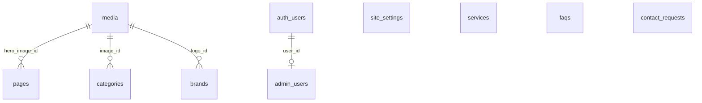

# Base de données et sécurité

Source de vérité : les migrations de `supabase/migrations/`. Ce document les résume.

## Vue d'ensemble



| Table | Rôle | Lecture publique | Écriture |
| --- | --- | --- | --- |
| `site_settings` | ligne unique (`id = 1`) : nom, signature, adresse, téléphone, horaires, réseaux, SEO, mentions légales | oui | administrateurs |
| `pages` | textes des pages (titre H1, intro, sections, SEO, image principale) | pages publiées | administrateurs |
| `categories` | univers (femme, homme, nuit, bain, chaussettes, accessoires) | univers actifs | administrateurs |
| `brands` | marques | marques publiées | administrateurs |
| `services` | services de la page Conseil | services publiés | administrateurs |
| `faqs` | questions fréquentes | questions publiées | administrateurs |
| `media` | photothèque : chemin dans le bucket, texte alternatif | oui | administrateurs |
| `contact_requests` | demandes du formulaire | **jamais** | insertion serveur (clé secrète), suivi par les administrateurs |
| `admin_users` | comptes autorisés à administrer | sa propre ligne | SQL uniquement |

### Points de conception

- **Rien n'est inventé.** Adresse, téléphone, horaires, coordonnées GPS et mentions légales sont `NULL` au départ. Le site masque ce qui est vide, et le tableau de bord de l'administration liste ce qui manque.
- **Pages : structure fixe, textes libres.** `pages.sections` est un tableau JSON `[{ key, heading, body }]`. Les clés sont définies par le code (mise en page) ; la gérante modifie les titres et les textes. Une section absente de la base est complétée par le texte par défaut.
- **Horaires** : `opening_hours` est un tableau JSON `[{ "day": "monday", "periods": [{ "opens": "09:30", "closes": "12:30" }] }]`, validé par Zod avant l'enregistrement et à la lecture.
- **Contraintes CHECK** sur toutes les longueurs et tous les formats (slug, e-mail, code postal, SIRET, chemin d'image…), alignées sur les schémas Zod de `src/lib/validation/content.ts`.
- **Évolution vers le e-commerce** : les univers et les marques ont des identifiants stables (`slug`) et des tables séparées, sur lesquels une table `products` pourra s'appuyer plus tard sans tout reprendre.

## Rôle administrateur

```sql
create function public.is_admin() returns boolean
language sql stable security definer set search_path = ''
as $$ select exists (select 1 from public.admin_users where user_id = (select auth.uid())) $$;
```

- L'identité vient du jeton Supabase Auth (`auth.uid()`), jamais d'un paramètre envoyé par le navigateur.
- `security definer` permet de consulter `admin_users` sans l'exposer ; `search_path = ''` empêche le détournement de la fonction.
- Aucune politique n'autorise l'écriture dans `admin_users` : on ne peut pas se déclarer administrateur depuis le site, même déjà administrateur.

Côté application, chaque page et chaque action de `/admin` appelle `requireAdmin()` (`src/lib/auth/admin.ts`). Cette fonction valide la session auprès du serveur Supabase (`getUser`) puis appelle `is_admin()`. Le proxy (`src/proxy.ts`) ne fait qu'une redirection de confort vers la page de connexion : ce n'est pas un contrôle de sécurité. La RLS reste la dernière barrière, même si le code applicatif comportait une erreur.

## Politiques RLS

La RLS est activée sur **toutes** les tables du schéma `public`.

| Table | anon | authenticated non admin | administrateur |
| --- | --- | --- | --- |
| contenus (`pages`, `brands`, `services`, `faqs`) | `select` si publié | `select` si publié | `select`, `insert`, `update`, `delete` |
| `categories` | `select` si actif | `select` si actif | tout |
| `site_settings`, `media` | `select` | `select` | `update` (réglages), tout (médias) |
| `contact_requests` | aucun droit | aucune ligne visible, aucune insertion | `select`, `update`, `delete` |
| `admin_users` | aucun droit | sa propre ligne | sa propre ligne |
| `storage.objects` (bucket `site-images`) | lecture via URL publique | rien | liste, envoi, remplacement, suppression |

`(select public.is_admin())` est écrit entre parenthèses pour que PostgreSQL ne l'évalue qu'une fois par requête.

## Formulaire de contact

1. Le navigateur envoie le formulaire à une Server Action (`src/app/(site)/contact/actions.ts`).
2. Le serveur rejette les robots les plus simples (champ piège, envoi en moins de 3 secondes), valide tous les champs avec Zod, puis vérifie la limite d'envois : 3 par empreinte IP sur 10 minutes, 40 au total par heure.
3. L'insertion se fait avec la clé secrète, côté serveur uniquement, avec l'horodatage du consentement et la version de la politique de confidentialité.
4. Les messages d'erreur ne révèlent aucun détail technique ; le détail part dans les journaux serveur.

Ces protections réduisent le spam sans le supprimer. Si du spam passe malgré tout, on peut ajouter un CAPTCHA respectueux de la vie privée (Friendly Captcha, Cloudflare Turnstile), mais c'est un service tiers à déclarer dans la politique de confidentialité.

L'adresse IP n'est jamais stockée en clair : seule une empreinte SHA-256 salée (`CONTACT_IP_SALT`) est conservée, pour la limitation.

## Stockage des images

- Bucket `site-images`, **public en lecture** : il ne contient que des images affichées sur le site public. N'y déposez jamais de document privé.
- Formats acceptés : JPEG, PNG, WebP et AVIF ; taille maximale 5 Mo. Ces limites sont appliquées par le bucket et vérifiées par le serveur, qui contrôle aussi le contenu réel du fichier, pas seulement son extension.
- Noms de fichiers normalisés : `2026/10/comptoir-de-la-boutique-a1b2c3.jpg`.
- Texte alternatif obligatoire, sauf image explicitement marquée comme décorative.

## Purge des demandes de contact

La politique de confidentialité annonce une conservation de 12 mois au maximum. La fonction `public.purge_contact_requests()` supprime les demandes plus anciennes. Elle n'est exécutable ni par les visiteurs ni par les comptes connectés.

- À la main : **SQL Editor** → `select public.purge_contact_requests();`
- Automatiquement, avec l'extension `pg_cron` (Database → Extensions) :

  ```sql
  select cron.schedule('purge-demandes', '0 3 * * 1', $$ select public.purge_contact_requests() $$);
  ```

## Vérifier sur le projet réel

Les tests `npm run test:db` utilisent un PostgreSQL local avec une reproduction minimale de Supabase. Après avoir appliqué les migrations sur le vrai projet :

1. **Database → Advisors (Security)** : aucune alerte « RLS disabled » ni « function search_path mutable » ne doit apparaître.
2. Dans **SQL Editor**, simulez un visiteur :

   ```sql
   set role anon;
   select count(*) from public.contact_requests;  -- doit échouer (permission denied)
   reset role;
   ```

3. Essayez `/admin` avec un compte qui n'est pas dans `admin_users` : l'accès doit être refusé.

## Sauvegarde

Voir le README, section 13. Toute modification destructive (suppression de colonne, de table, de données) doit faire l'objet d'une nouvelle migration, relue et testée sur un projet de test, après une sauvegarde.
